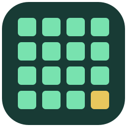
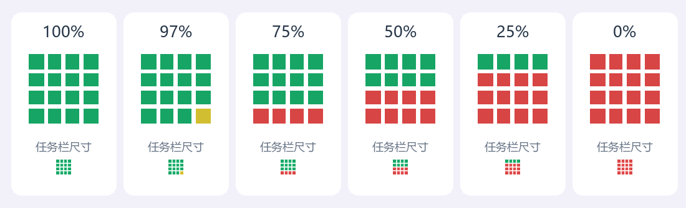
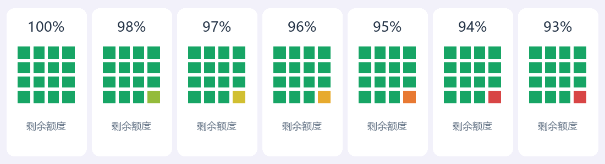
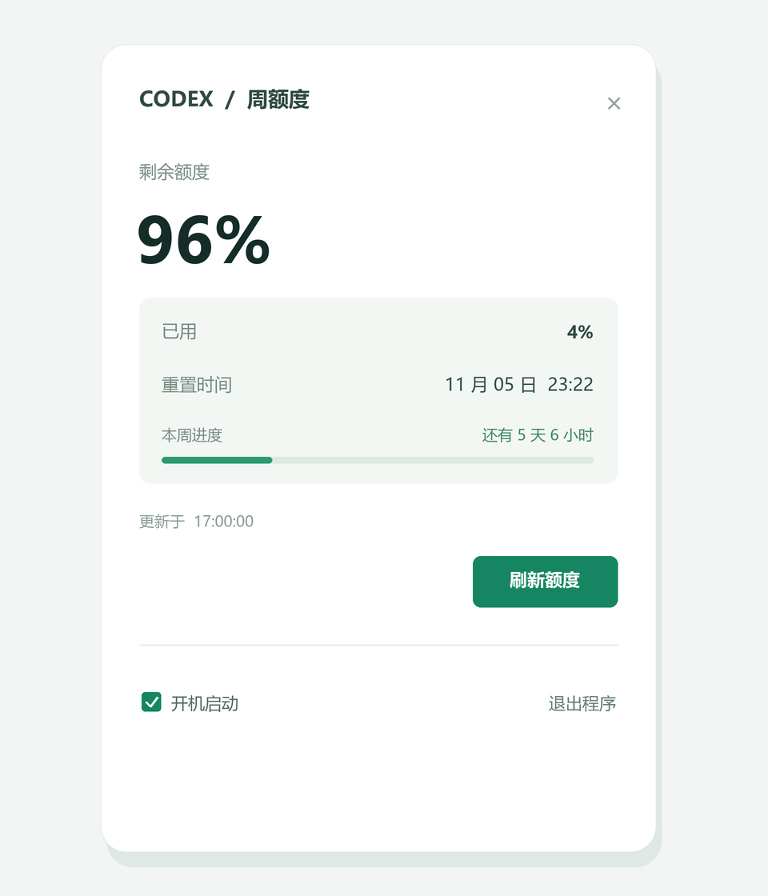

# Codex 周额度

一个轻量的 Windows 托盘工具，用 16 个格子显示 Codex 周额度的剩余情况。平时只看图标；点击图标后查看精确百分比和重置时间。

<p align="center"></p>

## 一眼查看剩余额度

16 个格子共代表 100% 的周额度。每格约代表 6.25%，格子逐个消耗；已消耗的格子保持红色，正在消耗的格子会随进度变色。



当前格子的颜色依次从绿色过渡到黄绿、黄色、橙色和红色，耗尽后保持红色。例如，下图中 94% 时最后一格接近用完，93% 时用完并保持红色：



图片中的数值仅作说明，实际图标以账户返回的数据为准。托盘图标大小和色彩辨识度可能因 Windows 缩放、主题和屏幕而不同。

## 详情卡片

点击任务栏中的格子图标，即可查看剩余及已用比例、重置时间、距离重置的倒计时和最近更新时间；也可以在卡片中刷新额度、设置开机启动或退出程序。



上图为界面示意，额度和时间仅为示例。时间进度条按 7 天周期展示已过去的比例，倒计时每分钟更新；它与剩余额度是两个独立指标。

## 功能

- 左键或右键点击托盘图标，打开或收起详情卡片。
- 查看周额度剩余百分比、已用百分比、重置时间和上次更新时间。
- 查看本周时间进度和距离重置的倒计时；达到重置时刻后提示等待额度更新。
- 每 15 分钟自动刷新，也可以手动刷新。
- 在详情中开启或关闭当前用户的开机启动，或退出程序。
- 刷新失败时保留上次数据，格子变灰并在详情中提示。

## 下载与使用

1. 前往 [Releases](../../releases/latest)，下载 `Codex-Weekly.exe`。
2. 在 Windows 上运行程序；无需单独安装 Python。
3. 确保本机 Codex 已登录 ChatGPT 账户。程序启动后会读取当前 Windows 用户的 Codex 登录状态。
4. 在任务栏通知区域找到格子图标。若图标被隐藏，点击任务栏的 `^`，或在 Windows 的任务栏设置中调整显示。
5. 点击图标，查看详情并进行设置。

如果移动 EXE 的位置，建议在详情中先关闭、再重新开启开机启动，以更新启动路径。

## 数据与隐私

程序从当前用户目录的 `.codex/auth.json` 中读取现有登录信息，并通过 HTTPS 向 `chatgpt.com` 请求额度数据。程序不会将登录信息写入项目文件；请勿将 `auth.json`、令牌或账户信息提交到 GitHub。

程序查找接口返回的 **7 天窗口**。如果账户没有返回该窗口、登录失效或网络不可用，详情页会提示；部分账户或登录方式可能不支持。额度接口属于实际使用中的服务接口，未来可能发生变化。

## 从源码运行与打包

需要 Windows、Python 3.12、Pillow 和 pywin32：

```powershell
python -m pip install -r requirements.txt
python codex_weekly.py
```

打包独立 EXE：

```powershell
python -m pip install pyinstaller
python -m PyInstaller --noconfirm --clean --onefile --windowed `
  --name "Codex周额度" --icon "$PWD\assets\icon.ico" `
  --version-file "$PWD\version.txt" --exclude-module numpy codex_weekly.py
```

生成的程序位于 `dist/`。应用图标的矢量源文件是 [`assets/icon.svg`](assets/icon.svg)；任务栏格子由程序动态绘制。
